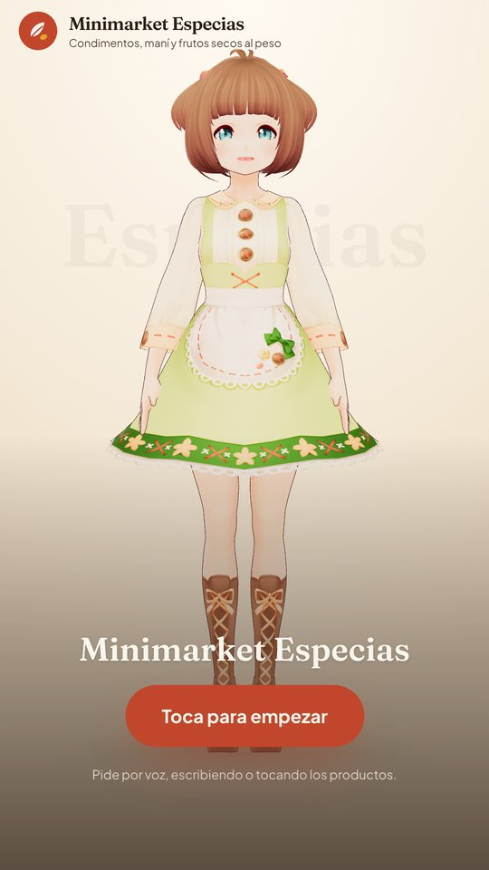
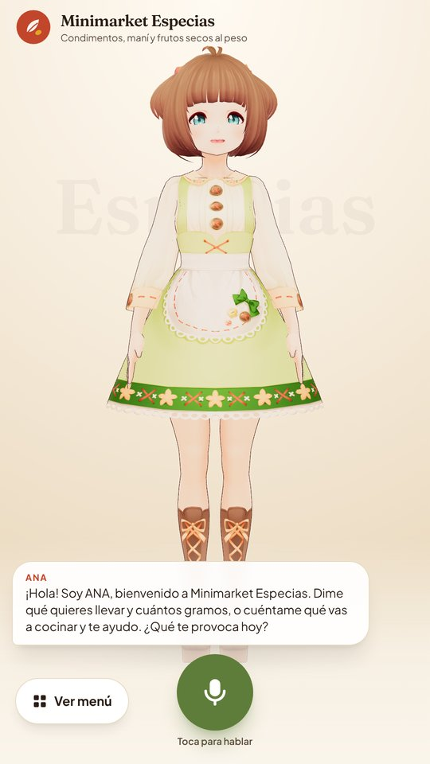
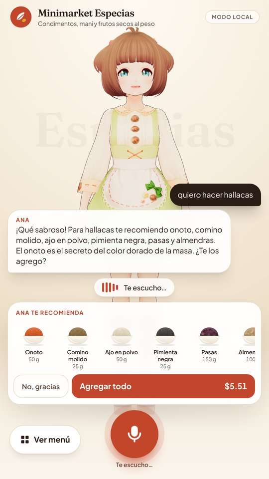
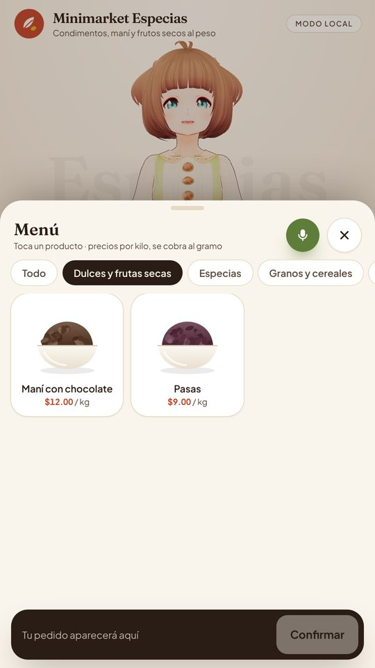
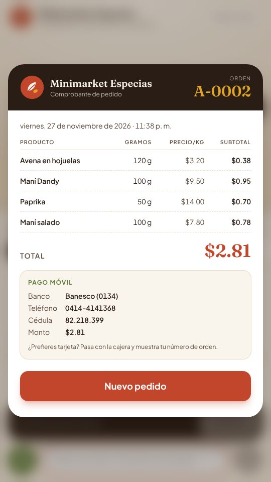
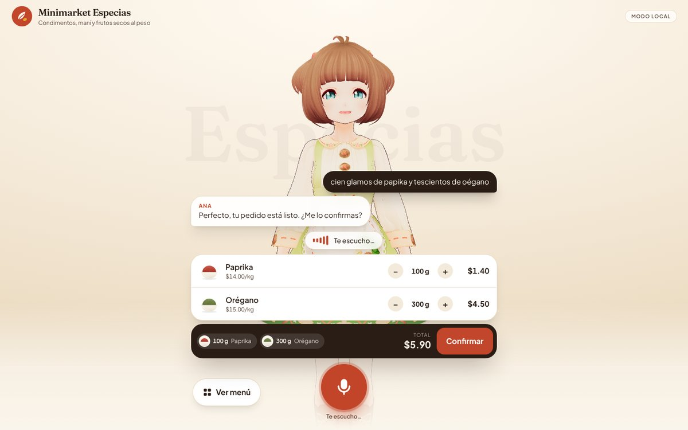
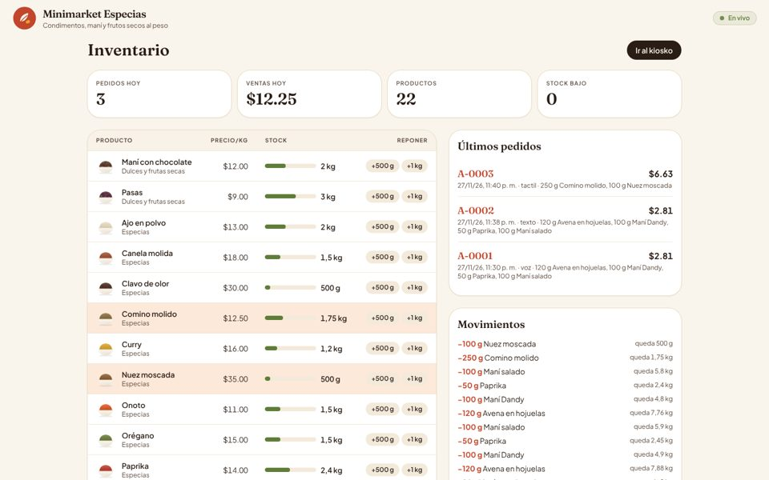

# Kiosko con ANA · Minimarket Especias

Kiosko digital de autoservicio para una tienda de condimentos, maní y frutos secos que vende al peso. Lo guía **ANA**, una asistente virtual en 3D que habla, escucha y toma pedidos. El cliente pide hablando (no hay teclado: nadie escribe en un kiosko) o tocando el menú, ANA le recomienda qué llevar según lo que va a cocinar, y al confirmar el inventario se descuenta en la base de datos.

| Bienvenida | ANA te escucha | Asistente de ventas | Menú cuando no entiende | Factura |
|---|---|---|---|---|
|  |  |  |  |  |

| Portátil (horizontal) | Panel de inventario en vivo (`/admin`) |
|---|---|
|  |  |

## Instalación en 3 comandos

Requisitos: Node.js 20 o superior. Para la voz, Chrome o Edge.

```bash
npm install
npm run setup     # crea .env, aplica migraciones y carga los 22 productos de ejemplo
npm run dev       # abre http://localhost:3000  (inventario en /admin)
```

Sin claves de IA la demo funciona completa con el intérprete local de pedidos. Para activar la IA, pon tus claves en `.env` (ver abajo) y reinicia.

Para producción: `npm run build && npm start`.

## Variables de entorno

Todo está documentado en [`.env.example`](.env.example). Lo principal:

| Variable | Para qué |
|---|---|
| `DATABASE_URL` | SQLite local (`file:./dev.db`). Para Postgres, cambia el `provider` en `prisma/schema.prisma` y la URL. |
| `GROQ_API_KEY`, `GROQ_MODEL` | IA principal. Gratis en [console.groq.com](https://console.groq.com/keys). Modelo por defecto `llama-3.3-70b-versatile`. |
| `GEMINI_API_KEY`, `GEMINI_MODEL` | IA de respaldo. Gratis en [aistudio.google.com](https://aistudio.google.com/apikey). Modelo por defecto `gemini-2.0-flash`. |
| `LLM_PROVEEDORES` | Orden de intento, por defecto `groq,gemini,local`. |
| `NEXT_PUBLIC_TIENDA_*`, `NEXT_PUBLIC_PAGO_*` | Nombre de la tienda y datos de pago móvil que dice ANA y salen en la factura. |
| `NEXT_PUBLIC_AVATAR_URL` | Ruta del modelo 3D (por defecto `/models/ana.vrm`). |

Las claves solo se leen en el servidor (`lib/llm.ts`); nunca llegan al navegador.

## Cómo funciona

```
Cliente (voz / texto / toque)
   │
   ▼
Kiosko (Next.js + R3F)  ──POST /api/ana──►  Agente (lib/agente)
   ▲   ANA 3D + voz                           │ 1. Groq  (tool calling)
   │                                          │ 2. Gemini (si Groq falla)
   │                                          │ 3. Intérprete local (sin IA)
   │                                          ▼
   │                                   Herramientas validadas con Zod
   │                                   buscar_productos · agregar_al_carrito ·
   │                                   quitar_del_carrito · cambiar_cantidad ·
   │                                   ver_carrito · vaciar_carrito · confirmar_pedido
   │                                          │
   └──────── carrito, respuesta, factura ◄────┤  precios, totales y stock: SIEMPRE del servidor
                                              ▼
                                   SQLite (Prisma): productos, pedidos,
                                   items_pedido, movimientos_inventario
                                              │ evento
                                              ▼
                                   /admin (Server-Sent Events, al instante)
```

Decisiones importantes:

- **El LLM no calcula ni escribe en la base.** Solo elige herramientas. Los precios son centavos enteros por kilo y el subtotal se redondea al centavo (`lib/dinero.ts`).
- **Confirmación segura.** `confirmar_pedido` solo funciona si ANA ya había pedido confirmación antes del mensaje del cliente, así el modelo no puede agregar y cerrar en el mismo turno. Un "sí / confirmo / perfecto" se cierra sin pasar por la IA, más rápido y sin ambigüedad.
- **Descuento atómico.** `confirmarPedido` usa una transacción con un `UPDATE ... WHERE stock >= gramos` por línea. Si no alcanza, esa línea se rechaza, ANA lo explica y el resto sigue. Dos kioskos a la vez nunca dejan el stock negativo (hay un test para eso).
- **Reconocimiento flexible.** Alias por producto ("dandy", "many", "paprica") más búsqueda difusa (Levenshtein por palabra). Un número solo son gramos; también entiende "medio kilo", "un cuarto", "1,5 kg" y números en palabras.
- **La frase de pago la arma el servidor** con los datos reales de `.env`, nunca el modelo.

### Estructura

```
app/                 páginas y API (kiosko en /, inventario en /admin)
components/          interfaz del kiosko, factura y panel admin
components/ana/      escena 3D y avatar (animación procedural y lip sync)
lib/agente/          agente: prompt de ANA, herramientas, intérprete local
lib/llm.ts           capa de proveedores (Groq, Gemini; fácil de ampliar)
lib/pedidos.ts       cotizar, confirmar (transacción) y reponer stock
lib/interpretar.ts   parser de pedidos en español
lib/buscar.ts        búsqueda difusa por nombre y alias
lib/cliente/         estado, orquestación de la experiencia, voz y boca
prisma/              esquema, migración, catálogo y seed
tests/               lógica de pedidos, inventario, parser y agente
```

## Voz

ANA usa la mejor voz disponible según las claves que pongas en `.env`. Sin claves todo funciona con la voz del navegador.

| | Con `ELEVENLABS_API_KEY` | Solo con `GROQ_API_KEY` | Sin claves |
|---|---|---|---|
| **Hablar** | ElevenLabs (voz CLARI, venezolana) | navegador | navegador |
| **Escuchar** | ElevenLabs Scribe | Groq Whisper | Chrome / Edge |

- **ElevenLabs (hablar):** `/api/tts` llama a `text-to-speech/{voz}/with-timestamps` con `eleven_flash_v2_5` (la más rápida). La clave nunca llega al navegador. La respuesta trae el tiempo de cada letra, así que la boca de ANA hace la vocal que está sonando y se abre según el volumen real del audio. El saludo se genera al cargar la página para que suene sin espera. Si ElevenLabs falla, habla el navegador.
  - Cambia la voz con `ELEVENLABS_VOICE_ID` (por defecto `9Ux14cxOYULytGFBVsW4`, CLARI) y la velocidad con `ELEVENLABS_VELOCIDAD`.
- **Escuchar:** el micrófono graba hasta que el cliente deja de hablar (detección de silencio, máximo 12 s) y `/api/stt` transcribe con ElevenLabs Scribe; si falla, con Groq Whisper, al que se le pasan los nombres de los productos para que los reconozca mejor. Sin claves se usa `SpeechRecognition` del navegador.
- **Manos libres:** cuando ANA termina con una pregunta, vuelve a escuchar sola. El botón grande del centro también sirve para hablar o detenerla.
- **Pronunciación:** ANA entiende a quien no pronuncia la r o la cambia por l (*"papika"*, *"oégano"*, *"meley"*, *"pefecto"*, *"tescientos glamos"*). La búsqueda compara también una forma fonética de cada palabra (`fonetica()` en `lib/texto.ts`).
- **Sin claves:** Web Speech API con la mejor voz femenina en español del equipo (prioriza es-VE; en Edge suele aparecer "Paola") y boca guiada por el texto.

## Asistente de ventas

Si el cliente cuenta qué va a cocinar, ANA recomienda los productos de la tienda que lleva ese plato, con cantidades caseras y un consejo, y aparece una tarjeta con **Agregar todo** o **No, gracias**. Basta con decir *"sí"*.

> Cliente: *"Quiero hacer hallacas."*
> ANA: *"¡Qué sabroso! Para hallacas te recomiendo onoto, comino molido, ajo en polvo, pimienta negra, pasas y almendras. El onoto es el secreto del color dorado de la masa. ¿Te los agrego?"*

Platos incluidos: hallacas, pan de jamón, torta negra, chocolate caliente, arroz con leche, ponche crema, pollo al horno, carne mechada / pabellón, asado negro, curry, granola casera y pasapalos para una fiesta. Para sumar otro, agrega una entrada en `lib/recetas.ts`. Solo se sugiere lo que hay en existencia.

**Cuando ANA no entiende** (o el cliente dice algo con varias opciones, como *"maní"*), abre el menú táctil en la categoría que corresponde para que el cliente toque el producto.

**Teclado para pruebas:** abre `http://localhost:3000/?teclado=1` para que aparezca un campo de texto.

## Cambiar el modelo 3D

1. Consigue un avatar `.vrm` (VRM 0.x o 1.0) con licencia que permita tu uso. VRoid Studio exporta VRM gratis.
2. Comprime sus texturas (opcional, recomendado):
   ```bash
   python3 scripts/comprimir-modelo.py mi-avatar.vrm public/models/ana.vrm
   ```
   Necesita Python con Pillow. Las texturas RGB pasan a JPEG y las transparentes quedan en PNG; huesos, visemas y metadatos no se tocan.
3. Si usas otro nombre, cambia `NEXT_PUBLIC_AVATAR_URL`. Los modelos VRM 0.x (los de VRoid) y 1.0 se detectan solos. Si el modelo trae accesorios que no quieres mostrar, pon los nombres de sus nodos en `NEXT_PUBLIC_AVATAR_OCULTAR` (separados por coma).
4. El encuadre se calcula solo a partir de la altura del modelo. Las animaciones usan los huesos humanoides estándar de VRM, así que funcionan con cualquier VRM.

Animaciones: son procedurales (código en `components/ana/Avatar.tsx`): respiración, parpadeo aleatorio, micro movimientos de cabeza, mirada al cliente, saludo con la mano, gestos al hablar y caminata para entrar y salir. Mixamo exige iniciar sesión y redirigir clips de otro esqueleto, así que se optó por animación propia sin dependencias de licencia. Si prefieres clips, se pueden cargar con `THREE.AnimationMixer` sobre los huesos normalizados de `vrm.humanoid`.

## Tests

```bash
npm test
```

36 tests: cálculo por gramos y redondeo, descuento exacto de stock, stock insuficiente (rechaza la línea y deja pasar el resto), no vender de más, concurrencia entre dos pedidos, reposición, parser de pedidos (incluido el guion completo), búsqueda difusa, palabras dichas sin r, recetas y sugerencias, apertura del menú cuando no entiende, el flujo de ANA de punta a punta sin IA, y el agente con un LLM simulado (uso de herramientas, bloqueo de confirmación en el mismo turno, respaldo cuando la IA falla, argumentos inválidos).

## Guion de demo (2 minutos)

1. **(0:00) Bienvenida.** Pantalla vertical con ANA respirando y mirando al frente. Toca "Toca para empezar": ANA saluda con la mano y se presenta.
2. **(0:15) Pedido por voz.** ANA ya está escuchando (o pulsa el micrófono verde del centro) y di: *"Hola Ana, quiero pedir 120 gr de avena, 100 de dandy, 50 de paprika y otros 100 de maní salado"*. Mientras hablas se ve la onda y tu frase. ANA arma el carrito con animación, se despliega el detalle con gramos y subtotales, y responde: *"Perfecto, tu pedido está listo. ¿Me lo confirmas?"*.
3. **(0:40) Corrección táctil (opcional).** Sube la avena a 170 g con el botón + del carrito, o toca "Pasas" en el catálogo y agrega 250 g.
4. **(0:55) Confirmar.** Di *"Perfecto"* o pulsa Confirmar. ANA dice el total y los datos de pago móvil (Banesco 0134, 0414-4141368, CI 82.218.399) o que pases con la cajera.
5. **(1:10) Salida y factura.** ANA se gira y sale caminando; entra la factura con número de orden, productos, gramos, precio por kg, subtotales, total, fecha, hora y datos de pago.
6. **(1:25) Inventario en vivo.** En otra pestaña o pantalla, abre `/admin`: el stock de esos productos ya bajó y la fila se ilumina; el pedido aparece arriba. Pulsa "+1 kg" para reponer.
7. **(1:40) Asistente de ventas.** Pulsa "Nuevo pedido" y di *"quiero hacer hallacas"*: ANA recomienda los condimentos y basta con decir *"sí"*.
8. **(1:55) Stock insuficiente.** Pide *"900 gramos de nuez moscada"*: ANA dice cuánto queda y ofrece alternativas.

## Créditos y licencias

- **Avatar "Vivi"**: modelo de muestra de VRoid. Sus metadatos VRM declaran licencia **CC0**, uso permitido a cualquier persona y uso comercial permitido. Copia tomada de [madjin/vrm-samples](https://github.com/madjin/vrm-samples/tree/master/vroid/beta). Modificación en este proyecto: texturas recomprimidas (`scripts/comprimir-modelo.py`).
- **Voz:** ElevenLabs (cuenta propia de la tienda); voz CLARI de la biblioteca de ElevenLabs.
- **Fuentes:** Plus Jakarta Sans y Fraunces, licencia SIL Open Font License 1.1, empaquetadas vía Fontsource.
- **Ilustraciones de productos e isotipo:** propias del proyecto, generadas con `scripts/ilustraciones.ts`.
- **Librerías:** Next.js, React, Three.js, @react-three/fiber y drei, @pixiv/three-vrm, Framer Motion, Prisma, Zod, Tailwind CSS (todas MIT o Apache 2.0).
- **Precios y existencias del catálogo:** son de ejemplo. Edítalos en `prisma/catalogo.ts` y ejecuta `npm run setup`, o cámbialos en la base.

## Límites conocidos

- Sin clave de ElevenLabs la voz depende del navegador y su calidad varía. Con ElevenLabs cada frase consume caracteres del plan (las frases repetidas se guardan en memoria del navegador).
- La voz (ElevenLabs, Groq o Chrome) necesita internet y el micrófono exige `localhost` o HTTPS. El resto del kiosko funciona sin conexión en modo local.
- Las actualizaciones en vivo de `/admin` usan un bus de eventos en memoria: sirven con un solo proceso de servidor. Con varios servidores, cambia `lib/eventos.ts` por Redis o Postgres LISTEN/NOTIFY (el panel ya recarga cada 15 s como respaldo).
